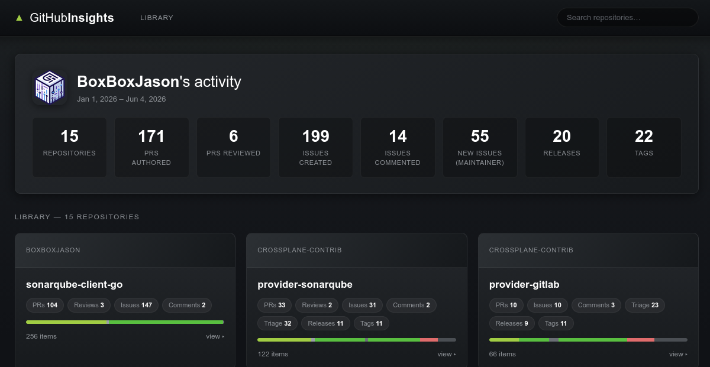

# github-insights

Collect comprehensive activity insights from GitHub. Track your contributions—pull requests, code reviews, issues, mentions, and releases—across a date range and output structured data for reporting, analysis, or documentation.



## Features

- **Pull Request Tracking** — Capture all PRs you authored and reviewed
- **Issue Analytics** — Track issues created and commented on
- **Mention Detection** — Find all mentions of your username across repositories
- **Release & Tag Monitoring** — Track releases and tags in repositories you maintain
- **Flexible Configuration** — Use YAML config, command-line flags, or environment variables
- **Structured Output** — JSON files organized by repository for easy analysis
- **Rate Limit Aware** — Efficient GitHub API usage with automatic rate limit handling

## Documentation

📖 **<https://boxboxjason.github.io/github-insights/>**

The documentation covers [installation](https://boxboxjason.github.io/github-insights/docs/installation/), every [command-line flag](https://boxboxjason.github.io/github-insights/docs/usage/), the [config file and environment variables](https://boxboxjason.github.io/github-insights/docs/configuration/), the [output files](https://boxboxjason.github.io/github-insights/docs/output/) and their [schema](https://boxboxjason.github.io/github-insights/docs/output-schema/), the [viewer](https://boxboxjason.github.io/github-insights/docs/viewer/) and [troubleshooting](https://boxboxjason.github.io/github-insights/docs/troubleshooting/). It is built from the [`docs`](./docs) directory of this repository, so it is updated together with the code.

## Quick Start

Install the latest release:

```bash
go install github.com/boxboxjason/github-insights@latest
```

Optionally provide a GitHub token (without one, pass `--username`):

```bash
export GITHUB_TOKEN="your_github_personal_access_token"
```

Collect activity for a date range:

```bash
github-insights --start 2024-01-01 --end 2024-03-31
```

The tool creates an `out/` directory with one JSON file per repository.

## Contributing

Contributions are welcome. Feel free to open issues or submit pull requests, and check [CONTRIBUTING.md](./CONTRIBUTING.md) first.
